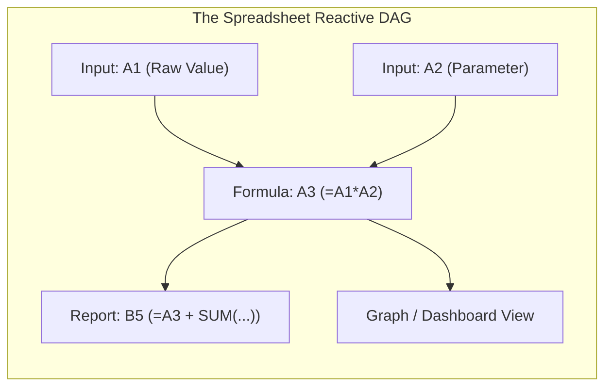
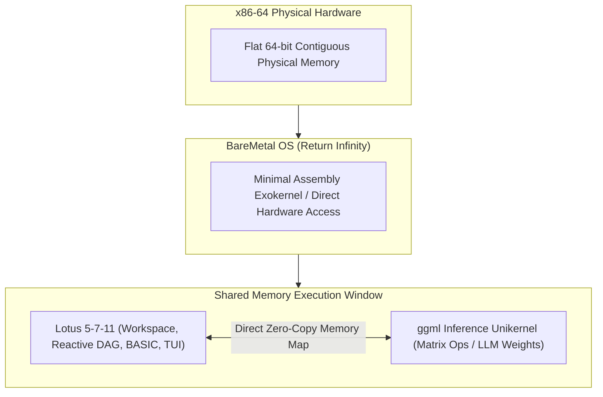

# Lotus 5-7-11: The Sovereign Computational Workspace

### *A Philosophical and Architectural Manifesto on Reactive Dataflow, Post-Chat AI Interfaces, and Bare-Metal Execution*

---

## 1. The Crisis of Modern Computational Overhead

Contemporary software is experiencing a crisis of compounding abstraction. 

To perform a basic calculation or draft a technical model today, a user typically interacts with an application layered atop an astounding tower of complexity: a multi-gigabyte web browser engine, megabytes of minified JavaScript, virtual DOM reconcilers, remote cloud synchronizers, and operating system kernels burdened by fifty years of legacy plumbing. 

Even standalone desktop productivity software has succumbed to structural decay. Documents are no longer singular, durable objects; they are opaque ZIP archives containing dozens of tangled XML schemas, fragile relationship graphs, and proprietary packaging quirks (such as Microsoft OOXML). To open, inspect, or modify a spreadsheet outside of its native monolith requires specialized parsing machinery. The user no longer owns a transparent document—they rent an ephemeral view into an opaque container.

**Lotus 5-7-11** begins with a deliberate rejection of this trajectory. 

It is an architectural declaration that computation should be local, immediate, inspectable, and sovereign. By returning to the foundational breakthrough of the personal computer—the programmable spreadsheet pioneered by Lotus 1-2-3—and synthesizing it with modern systems programming and artificial intelligence, Lotus 5-7-11 defines a new medium: **a portable, self-contained computational workspace that serves simultaneously as a human tool, a machine-readable artifact, and an operating substrate.**

---

## 2. Recovering the Undefeated Model: The Spreadsheet as Pure Dataflow

In modern computer science circles, spreadsheets were long dismissed as mere clerical calculators or financial toys. This was a profound historical oversight. 

The spreadsheet was the first, and remains the most successful, visual reactive programming paradigm ever conceived. Every cell in a worksheet is an autonomous reactive node; the entire grid is a directed acyclic graph (DAG) evaluated in topological order with immediate visual feedback. Inputs, intermediate states, formulas, and outputs reside in the same spatial plane. There are no hidden build steps, no detached compilation artifacts, and no disjointed stack traces: state and logic are visible in place.



Modern software development continuously attempts to reinvent this simplicity. Frameworks in the web ecosystem spend untold millions of engineering hours developing reactive state libraries, signals, and DAG recalculators. Yet Lotus 1-2-3 delivered this exact reactive immediacy in 1983 within a fraction of a single megabyte of memory.

Lotus 5-7-11 recovers this dataflow model, stripping away decades of enterprise bloat while modernizing the execution engine:
- **Clean-Room Dependency Graph**: An explicit, incremental topological evaluation engine capable of handling tens of thousands of dependent nodes in microseconds.
- **Embedded Modern BASIC**: Replacing the historical spaghetti of keyboard macros and arcane VBA with a clean, structured, modern BASIC dialect. It provides Turing-complete procedural capability (loops, structured branching, scoped procedures) strictly bounded by cell-access permissions and execution budgets.
- **Unified State**: Formulas represent declarative relationships; BASIC procedures represent procedural workflows. Both operate on the exact same underlying cell state without impedance mismatch.

---

## 3. Artifact Sovereignty: The Cell as a File and the Transparent Blob

A central architectural premise of Lotus 5-7-11 is that **the document is the container**.

```
[ NOTEPAD VIEW ]                     [ HEX EDITOR VIEW ]
<workbook id="lotus-001">           00000000: 3C 77 6F 72 6B 62 6F 6F  <workboo
  <cell ref="A1" type="num">10      00000008: 6B 20 69 64 3D 22 6C 6F  k id="lo
  <cell ref="B1" name="blob.bin"    00000010: 74 75 73 2D 30 30 31 22  tus-001"
        type="blob" bytes="16">     00000018: 3E 0A 20 20 3C 63 65 6C  >.  <cel
  [RAW UNCOMPRESSED BYTES]          00000020: 6C 20 72 65 66 3D 22 41  l ref="A
  </cell>                           00000028: 31 22 20 74 79 70 65 3D  1" type=
</workbook>                         00000030: 22 6E 75 6D 22 3E 31 30  "num">10
                                    00000038: 3C 2F 63 65 6C 6C 3E 0A  </cell>.
```

Rather than adopting a complex multi-file container model, a `.lotus` workbook is an uncompressed, text-framed binary blob. It can be opened and understood across every level of inspection:
1. **In Notepad**: The structure is immediately visible as human-readable UTF-8 markup. Coordinates, formulas, names, numbers, and embedded BASIC scripts read naturally.
2. **In a Hex Editor**: Clear ASCII framing markers delimit cells and payloads. When a cell contains raw binary data, its metadata tag explicitly specifies its byte length and name, followed by the exact uncompressed payload bytes.
3. **To the Operating System**: Named cells behave as file-like objects. Ejecting a named cell produces an exact byte-for-byte standalone file on disk; importing a file embeds its uncompressed bytes into the workbook.
4. **Dynamic Table of Contents (TOC)**: Rather than hard-coding catalog locations, the TOC is calculated dynamically at `(maxX + 1, maxY + 1)`—anchored precisely one cell beyond the active raster extent.

This format provides radical durability. Fifty years from now, a user or system encountering a `.lotus` file will not need a proprietary software suite or abandoned cloud runtime to understand what it contains. A text editor or a standard hex dump reveals the entire schema, data, and logic.

---

## 4. Beyond the Chat Bubble: The Workbook as an AI Chessboard

The modern paradigm of Human–AI interaction has hit an expressive ceiling: **the conversational chat bubble**.

Chatting with an AI in natural language is inherently high-friction for quantitative, procedural, and systemic work. Natural language is ambiguous, imprecise, non-deterministic, and context-hungry. To collaborate on a financial forecast, an engineering model, or a data transformation through a chat interface, the AI and human must continuously exchange paragraphs of text, infer assumptions, and mentally reconstruct the problem state.

Lotus 5-7-11 fundamentally changes this relationship by introducing **the workbook as a shared chessboard**.

```mermaid
sequenceDiagram
    autonumber
    actor Human as Human Operator
    participant Workbook as Lotus 5-7-11 (.lotus)
    actor AI as AI Co-Operator
    
    Human->>Workbook: Edits cell A1, establishes constraint in B1
    Note over Workbook: Dependency DAG recalculates downstream results
    AI->>Workbook: Directly inspects structured XML document & DAG
    Note over AI: Understands exact state, formulas, and constraints
    AI->>Workbook: Proposes mutation (replaces formula in C1, stages BASIC sim)
    Note over Workbook: Staging sandbox validates permissions & bounds
    Workbook-->>Human: Visual diff & recalculated cascade displayed in TUI
    Human->>Workbook: Approves commit via keyboard command (/)
    Note over Workbook: Changes committed; persistent state updated
```

### The Tenets of the Shared Chessboard:
- **Shared Ground Truth**: The workbook is the persistent state. The human and AI do not exchange explanations of the state; they both point to the same artifact.
- **Turn-Based Structured Operations**: The AI does not generate ephemeral conversational text; it proposes structured document modifications (e.g., editing cell `B4`, updating an expression, or embedding a simulation procedure).
- **The Grid as a Generative TUI**: The spreadsheet grid is itself the generative UI. When an AI designs a dashboard, parameter tuning interface, or comparison matrix, it does not write bespoke front-end code or render a static image. It assembles native, styled cells (with colors, borders, fonts, and formulas). The result is fully interactive, navigable by the human via keyboard, and completely reusable.

---

## 5. Radical Minimalism: BareMetal OS, Unikernels, and `ggml`

While enterprise AI software continues to build upward into ever-deeper software towers (Python $\to$ PyTorch $\to$ CUDA $\to$ Container $\to$ Kubernetes $\to$ Cloud), a parallel counter-culture is proving that radical minimalism outperforms abstraction bloat. 

Projects like Georgi Gerganov’s `ggml` and `llama.cpp` demonstrated that machine learning inference does not require Python or massive framework runtimes; it requires tight loops, efficient matrix kernels, and direct control over memory.

Lotus 5-7-11 is designed to meet this minimalist frontier:



### The Exokernel & Unikernel Synthesis:
1. **BareMetal OS by Return Infinity**:
   BareMetal OS is a pure 64-bit assembly exokernel. It eschews the overhead of general-purpose operating systems, offering raw access to x86-64 execution state and a flat physical memory space.
2. **Carrying Its Own Bags**:
   Implemented in Rust with a `#![no_std]` core, Lotus 5-7-11 handles its own memory space. It does not rely on an OS virtual memory allocator or libc `malloc`. It manages its internal structures out of an explicit memory arena passed to it at boot.
3. **The Control Cockpit for `ggml`**:
   Lotus 5-7-11 and a `ggml` unikernel can occupy adjacent windows of the same memory space. Lotus acts as the interactive control surface, parameter scratchpad, and data staging ground for the inference engine, with zero serialization overhead and zero operating system interference.

---

## 6. The Inverted Executable: The Program is the Document

In conventional computing, the program and the document are strictly segregated: the application binary lives in the OS file tree, and the document is an inert data file on disk.

Lotus 5-7-11 explores an architectural inversion: **the executable and the document can be unified into a single polyglot binary.**

```
+-----------------------------------------------------------------------+
|  CANONICAL PROGRAM ENTRY (x86-64 Executable / Boot Stub)             |
+-----------------------------------------------------------------------+
|  SETTINGS & AUTOEXEC CELL REGION (Reversed Binary Config)            |
+-----------------------------------------------------------------------+
|  ~~~~~~~~~~~~~~~~~~~~~~ COMPRESSED CHASM ~~~~~~~~~~~~~~~~~~~~~~~~~~~~  |
+-----------------------------------------------------------------------+
|  WORKBOOK CONTAINER (Cells, Payloads, Dynamic TOC, Embedded Docs)     |
+-----------------------------------------------------------------------+
```

- **Self-Executing Artifact**: The native workbook is executable in its own right. Transferring the workbook transfers the runtime required to calculate, edit, and interact with it.
- **Inverted Geometry**: The compiled machine code anchors one end of the 64-bit address space, and the workbook container anchors the other, separated by a structural chasm that supports representational fluidity.
- **File-Local Startup (`AUTOEXEC.BAT` role)**: A settings region immediately preceding the executable allows file-local configuration (calculation policies, compatibility switches) to govern initialization without compromising host isolation.

---

## 7. Conclusion: The Sovereign Horizon

Lotus 5-7-11 is not a nostalgic exercise in retro-computing. It is a deliberate reclamation of computational sovereignty.

By uniting:
- The **pure reactive dataflow** of the spreadsheet,
- The **transparency and durability** of an uncompressed, human- and AI-readable document format,
- The **procedural safety** of a sandboxed modern BASIC runtime,
- The **collaborative clarity** of a shared-state AI chessboard, and
- The **uncompromising efficiency** of bare-metal unikernel execution,

Lotus 5-7-11 demonstrates that personal computing does not have to remain trapped beneath layers of opaque bloat. A tool can be small. A document can be transparent. A computational medium can be fast, durable, and understandable by human and machine alike.
